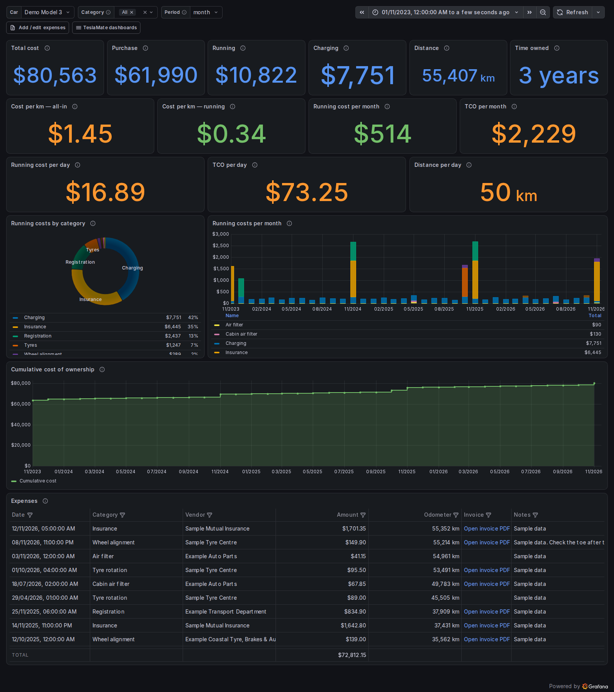

# What the dashboard counts

The **Cost of Ownership** dashboard sits in Grafana's **GarageBooks** folder (see step 6 of
[Setup](setup.md)). Its two links go to the app (**Add / edit expenses**) and back to TeslaMate's
own dashboards.

## The figures

All of them come from the `garagebooks.ownership` view (`garagebooks/schema.sql`), one row per car:

| Figure | Definition |
|---|---|
| Total cost | purchase + running expenses + charging, less the sale price once the car is sold (see [Selling a car](#selling-a-car)) |
| Charging | TeslaMate's `charging_processes.cost` for a car it tracks, plus expenses in a charging or fuel category (**Charging**, **Fuel**) |
| Distance | latest odometer (for a sold car, the highest known on or before the sale date) − odometer on the purchase expense (else the lowest odometer known). The odometer is TeslaMate's, a reading entered on the Cars page, or the one on an expense |
| Cost per km — all-in | total cost ÷ distance |
| Cost per km — running | (running + charging) ÷ distance, excludes the purchase price |
| Per day and per month | running (or total) cost, or distance, ÷ the time since purchase, or until the sale date for a sold car (at least one day, or one month) |

With no TeslaMate, the dashboard is written without TeslaMate's parts and counts what you entered.
When TeslaMate is there but its figures are held back (an untested version, or tables that can't be
read), a note at the top gives the reason, and the totals that need TeslaMate say *unavailable* for a
car it tracks instead of showing a figure with the charging missing. See
[Without TeslaMate](reference.md#without-teslamate).

The headline panels are all-time. The charts, pie and table follow the dashboard's time range, which
starts at your earliest data. Grafana has no "all time", so the app works the start out each time it
starts; a back-dated expense older than that needs the range widened by hand.

## Selling a car

Record the sale on the Cars page (see [Cars](index.md#selling-a-car)). For a sold car:

- **Total cost**, **TCO per month**, **TCO per day** and **Cost per km, all-in** are net of the sale
  price: purchase + running + charging − sale price. The sale price comes off only while a purchase
  category is ticked in the **Category** box, because it is what you got back of the purchase price.
  Running-only figures are not affected.
- **Time owned** and every per-day and per-month figure divide by the time from purchase to the sale
  date, not to today, so they stop growing once the car has gone.
- **Distance** stops at the sale: the highest odometer known on or before the sale date, whether
  TeslaMate's or one you entered. A reading or drive after the sale is ignored.
- The **Sold** tile reads *Sold 12 Mar 2026 · $31,000*, and shows a dash for a car you still own. The
  **Car** box adds *(sold)* after the car's name.
- Charging or expenses dated after the sale still count: they are real costs.

<!-- screenshot: dashboard-sold - The dashboard for a sold car, with the Sold tile and (sold) in the Car box -->

## Running costs per FBT year

Below the cumulative chart, bars show running costs for each FBT year (1 April to 31 March), labelled like
**FBT 2025–26** and stacked by category, with charging from TeslaMate included where there is a TeslaMate.
The year comes from each expense's date in the dashboard's time zone, so nothing is picked and it follows
the time range: a year cut off by the range shows only the part inside it. The purchase price is left
out. The same rule is in the database as `garagebooks.fbt_year(date)` (the year a date's FBT year starts
in), for queries of your own. The per-car report is described under [Leases](leases.md#the-fbt-year).

<!-- screenshot: dashboard-fbt - The Running costs per FBT year panel on the dashboard -->

## Rebates and refunds

A rebate or refund (a state EV rebate, an insurance refund for ending a policy early) is an expense
with a negative amount, such as `-3000`. It lowers the category's total and everything built on it,
so the cost figures are net of what you got back. The pie can't show a negative slice, so a category
whose total ends up below zero is left out of it.

## The boxes at the top

- **Car** picks the car.
- **Category** limits the headline cost figures (totals, per km, per day, per month) to the categories
  you pick. Charging counts as a category of its own. Distance and **Time owned** (shown as years and
  months) are not affected, and neither are the charts, pie and table.
- **Period** groups the running-cost bars and the cumulative chart by week, month or year.

## Colours and number formats

Charging and each starter category keep the same fixed, clearly different colour in the pie and the
bars (a colour-blind-safe set). Categories you add yourself take Grafana's default colours; to pin
one, add a colour override for that series name in the panel.

Currency is in dollars and distance in km. Digits are grouped, and the decimal mark chosen, by the
browser's language, so `$1,362.00` for English (Australia) and `$1.362,00` for German. Decimals are
fixed, so $1.30 a day keeps its zero.
