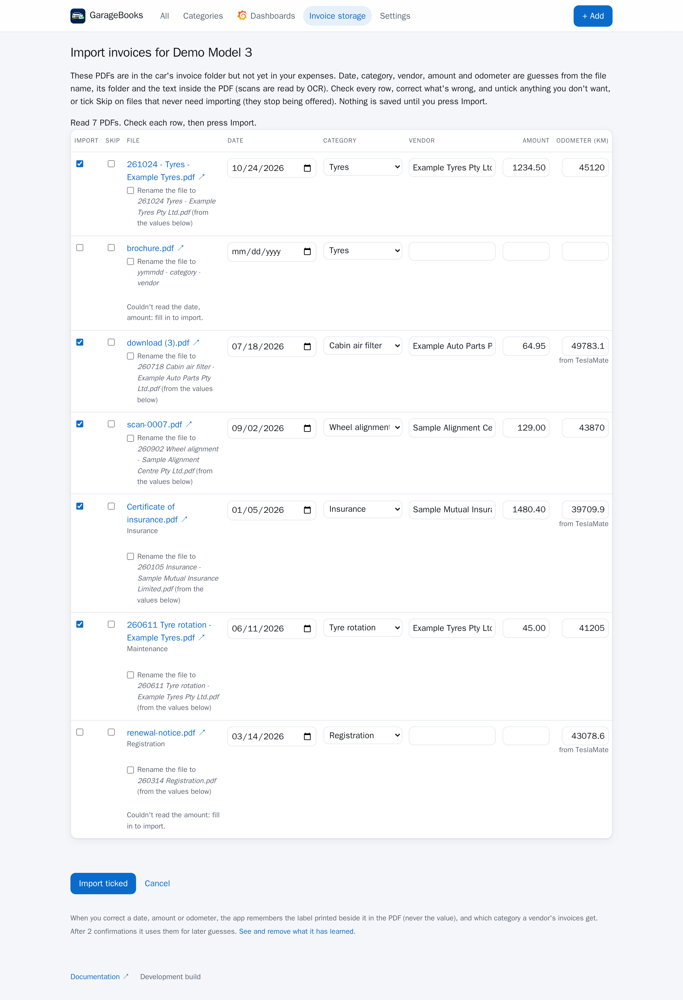

# Importing invoices

Invoices already in a car's folder (and its subfolders) can be turned into expenses in bulk, whether
that folder is in OneDrive or is the [invoice folder on the server](local-folder.md): on the
**Invoice storage** page, press **Import existing invoices** beside the car. Invoices and refunds that arrive
by email are imported on the same page from a car's Outlook mailbox folder: see [Invoices by email](mailbox.md).

The page opens at once and shows its progress (looking in the folder, then "Reading 3 of 10" with the
file's name) while it reads every PDF that isn't yet linked to an expense. It guesses each one's date,
category, vendor, amount and odometer, and shows them in a table to check, correct and untick. **Nothing is saved until you press Import**, and a
file already linked to an expense never appears again. Tick **Skip** on files that never need
importing (a brochure, say) and they stop being offered; **Offer them again** at the foot of the page
brings them back. When you press Import with some files left unticked, the page asks whether to
skip those too; choose Cancel to leave them for next time.

## How it guesses

The guesses come from **the PDF itself first**, because file names are often arbitrary: its text
(`Invoice Date`, a `Total` line, `Odometer`, the company or trading name, and which category it is about:
named in its heading, or mentioned most). The folder you filed it in comes next for the category, and the
file name is only the fallback for what the PDF doesn't say: a leading or trailing `yymmdd` date, a category
name, and the vendor in `Tyres - Tyre Shop`. A file name the PDF contradicts (it says Tyres, the PDF is a
registration notice) isn't used for the vendor. Scanned PDFs with no text are read
by OCR, which is slower and rougher. When a `Total due` line offers several amounts (a registration renewal for 6 or 12 months), **Settings →
When an invoice offers several amounts** picks the largest (the default), the smallest, or leaves it blank for
you. An amount is never guessed without a clear total, and
rows missing a date, category or amount start unticked. The image includes `poppler-utils` and
`tesseract-ocr` for this; without them the app still runs and simply proposes less.

A blank odometer is filled from TeslaMate's last position before the invoice date. Each row can also
be **renamed** where it is (in OneDrive, or in the folder on the server) to the [file name template](onedrive.md#file-names), built from the values
you confirm; a name already taken leaves the file as it is, and the expense is still imported.

The same reading works on a single invoice: on **+ Add**, choosing the invoice PDF fills in the date,
amount, vendor, category (when the file name or a learned vendor says) and odometer it can read,
without touching anything you've already typed.

## Skipping, notes and periods

A file that has no amount **and** nothing that reads as an invoice, receipt, notice or policy (no
`invoice`, `receipt`, `total`, `amount due`, `premium`, `renewal` or `policy` wording, in the text or the
file name) starts with **Skip** ticked and **Import** unticked, with a note saying so: untick Skip to import it
anyway. A file that does look like an invoice but is missing a field stays as before, unticked and not skipped.
A scan with no readable text is never skipped by default, because nobody can tell what it is.

Each row has a **Notes** field, saved to the expense's notes. It is filled in where it can be read easily: what an
insurance endorsement changes (`Change of address`, `Additional premium`, `Refund of premium`, `Policy
change`), a `Refund`, or the months a registration covers (`12 months registration`). Edit it freely.

Insurance and registration cover a stretch of time, so their rows (and the Add and Edit form, and the list) show
a **period**: the start and end dates, read from `Period of insurance: from … to …`, `Registration period`,
`Registration expiry date` (with the months, when the notice gives them) or `Policy start` and `Policy end`. When
a notice offers 6 and 12 months, Settings → When an invoice offers several amounts decides which one is read, as it does for the amount.
Which categories have a period is the **Has a period** tick on the **Categories** page (Insurance and
Registration are ticked to begin with), so a category you add, such as roadside assistance, can have one too.
A period can't end before it starts. Only a category with a period shows the fields: if a PDF in another category
names one, it stays out of sight and isn't saved, and appears if you change the row to a category that has a period.
(An expense that already has a period still shows it when you edit it.)

<!-- screenshot: import-row-period - An import row for an insurance policy, with its notes and period -->

## Lease forms and agreements

A PDF that is an associate lease form (it states its lease start and end dates or is titled an associate lease)
or a lease agreement isn't an invoice, so the import doesn't offer it as an expense. Its row says what it is.
If the car has a lease starting on the date the form states, the row is ticked to **keep the file with that
lease** as its lease form (an agreement goes to the car's lease when it has just one); the lease page then links
to it. If there is no such lease yet, the row offers **Add a lease from this**, which opens the Add a lease page
where you choose the file to fill in the boxes. A lease that already has that document isn't offered it again.
Such a file is never renamed or moved: its row has no rename option. For an invoice, the **Rename** box
starts unticked, so nothing is renamed unless you tick it.

<!-- screenshot: import-lease-row - An import row for an associate lease form, ticked to keep it with the lease it matches -->

## Several PDFs in one expense

An invoice and its service report, or a receipt and its photos, are one expense. On the import page, choose **Attach
to** on the extra PDF's row and pick the row they belong to (rows are listed by number and file name; the row above is
marked). Pressing Import then creates one expense for the main row, with its PDF as the invoice, and keeps the others
as **Attached documents** of that expense. The attached row is imported and skipped with the main row, not on its own,
so the main row must be ticked. Attaching a row to one that is itself attached follows the chain to the main row.

The expense's **Edit** page lists its attached documents with links, and **Remove** forgets one (the file stays
where it is, and the import offers it again). Attached files count as known, so they are never offered for import
again; deleting the expense deletes the list of its documents, never the files.

<!-- screenshot: import-attach - An import row with the Attach to choice, and the Attached documents list on the Edit page -->

## The car's details, and a folder for a new car

Importing the **initial purchase** invoice (any category of the purchase kind) offers to fill in the car's details:
VIN, year built, model year and body type, read from labels such as `VIN` or `Vehicle identification number`,
`Year of manufacture` or `Build date` (year built), `Model year` or a plain `Year` (model year) and `Body type`. The
row shows the values in a **Fill in the car's details from this invoice** box, ticked to begin with: correct them or untick
it. Only details the car has no value for are offered and filled in; nothing it already has is replaced, and the
name, make and model (which a TeslaMate car takes from TeslaMate) are never touched. The Cars page edits the same fields.

A car that isn't in the list yet: on the **Invoice storage** page, **Folder for a new car** browses for its folder
(in OneDrive or on the server) and opens the import of that folder. The car is made when you press Import, from the
purchase invoice you ticked (its make and model name it, and its details are filled in; with neither, it is named
after the folder, and its type starts as battery electric: change it on the Cars page). With no purchase invoice
ticked, a dialog asks for the car's name, type and details first, and nothing is saved until you complete it. The folder
becomes the car's invoice folder. None of this needs TeslaMate.

<!-- screenshot: import-new-car-dialog - The dialog that asks for a new car's details when no purchase invoice is ticked -->

## A registration's GST and payment references

GST on a registration is only on its CTP insurance part, so it isn't a tenth of the total. When a **Registration**
notice states its GST (the `incl GST of $x` figures on the CTP breakdown's `Total CTP insurance premium` line, on the notice's last page, or else a `GST` line with a dollar figure; the larger or smaller of two on one line, as the Settings
choice for several amounts says), the row shows it in **GST in the amount** and the expense stores it. A stored GST
replaces the category's GST rule in the [cost after tax](leases.md): the amount less that GST is what the after-tax cost
is worked out on. Registration starts as **GST only partly applies** on the Categories page, so with no GST read or entered
no GST is counted.

The notice's **card payment reference** (the `Ref:` under `Enter Payment Reference Number`), **BPAY biller code** and **BPAY reference** are kept with the expense, in a
**Payment references** section of the Edit form that starts closed. Only categories in the **registration** budget pool
(Registration, as installed) have the section or keep references: changing an expense to another category drops them. They are never shown in the expense list or tiles,
on the dashboard, or in the change history's displayed values. When you
[claim the expense](leases.md), the claim page starts with the stored GST in its GST field (empty it to leave the GST
to the provider).

## Service items

An expense in the **Service** category records what the service covered: tick the items (fuel filter, oil filter,
engine oil, tyre rotation, windscreen washer fluid, windscreen wipers, brakes, brake fluid, timing belt, air filter,
coolant, cabin air filter) on its import row, or on the Add and Edit form. On an import row, the items whose names
appear in the PDF (whole words, any case) are ticked for you. The items only show while the category is Service, and are
dropped if you change the category. The Service category is in the maintenance lease budget pool to begin with.

The list is yours: **Categories → Service items** adds, renames and deletes items (a small **×** on its row deletes one; deleting one takes it off the
expenses that had it; renaming keeps it on them). Missing one while importing? **Add an item…** on the row opens a
dialog; the new item is added to every row's list and ticked on the row you were in, and nothing else on the
page changes.

<!-- screenshot: categories-page - The Categories page: every category and service item in one form with one Save button, and the small x that deletes a service item -->

<!-- screenshot: import-service-items - An import row in the Service category, with its service items and the Add an item dialog -->

## Possible duplicates

Possible duplicates are flagged. Saving a new expense (the Add form) that has the same car and exactly
the same amount as one within 14 days either side asks first: it lists the match with a link to open it, and
**Save anyway** saves the new one regardless. The question comes before anything is uploaded or saved, and the
server asks again if the page's own check was skipped. The import preview does the same per file, leaving a
likely duplicate unticked with a link to the expense it resembles.

<!-- screenshot: duplicate-warning - The question asked before saving a possible duplicate -->

## The vendor

A **registration** notice's vendor is the authority that issues it (for example `Department of Transport and Main Roads`),
not the CTP insurer the notice also names.

The vendor is the name the document trades under: a line such as `Example Insurer Limited ABN … trading as
Brand Cover` gives `Brand Cover`, not the legal company (only when the words before "trading as" read as a
company name, so a footnote about someone else's insurer doesn't count). A vendor in the file name
(`261030 - Wheel Alignment - Tesla.pdf`) still comes first, and without a trading name the company named at the
start of a line is used.

## Learning from your corrections

The importer learns from your corrections. When you change or fill in a date, amount or
odometer, it re-reads that PDF and finds your value in the text: the label printed beside it
(for example `Annual premium` or `Date of issue`) is remembered, never the value itself. It also
remembers which category you gave each vendor's invoices. A label or vendor is used for later
guesses once you've confirmed it twice; a learned label that finds two different values in one
PDF leaves the field blank rather than guessing. Nothing is learned if your value isn't in the
PDF text. **Import page → See and remove what it has learned** lists everything and lets you
delete it. This stores only short labels and vendor names, in the `garagebooks` schema.

<!-- screenshot: learned-page - The page listing what the importer has learned -->
