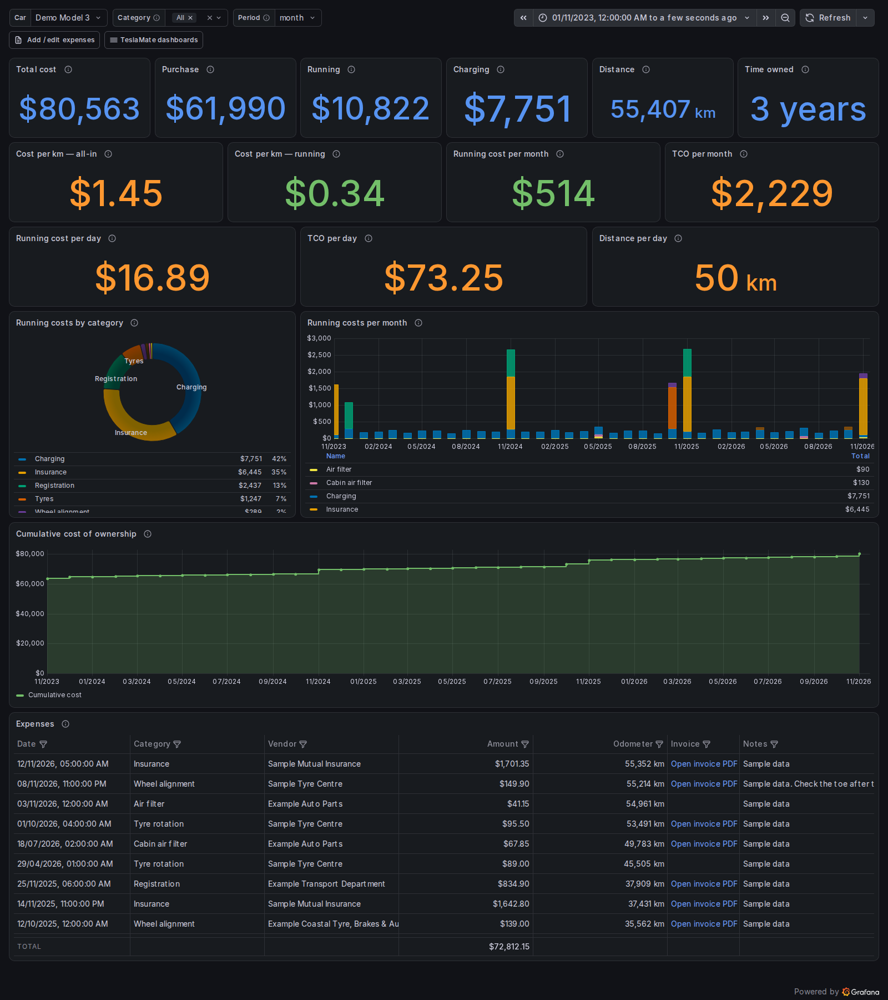
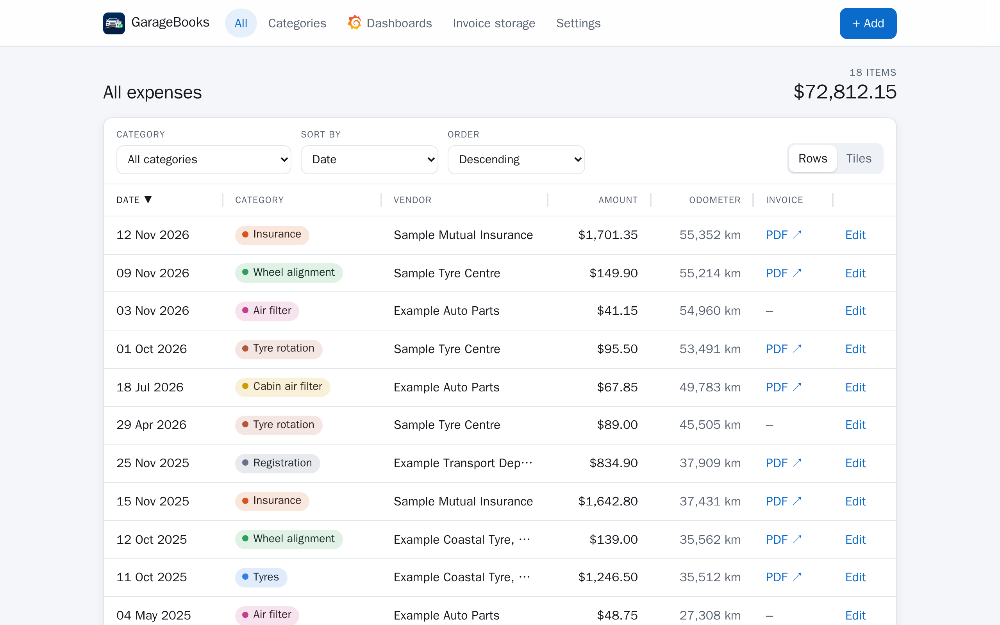
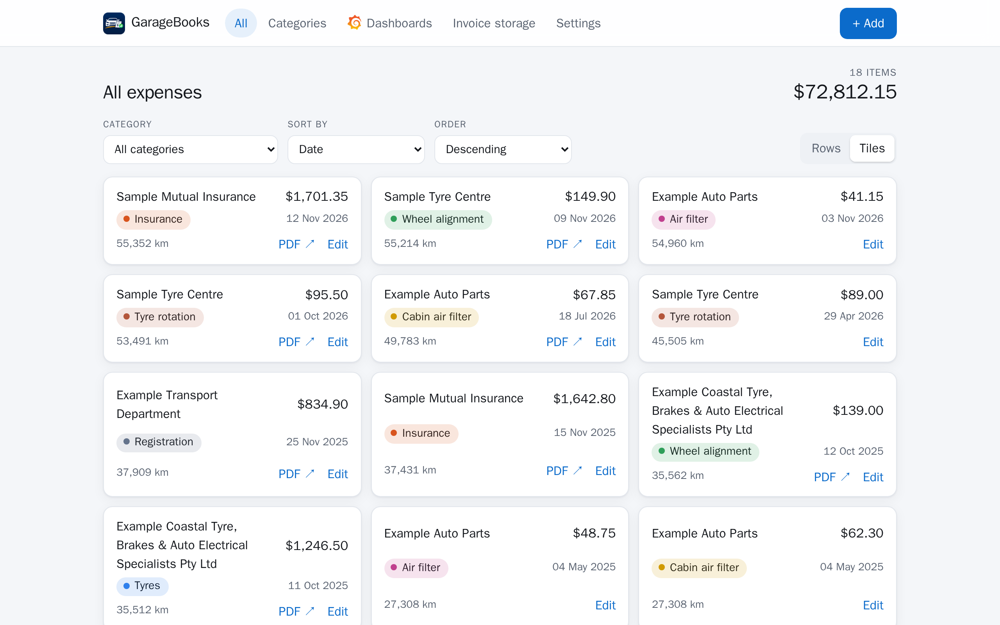
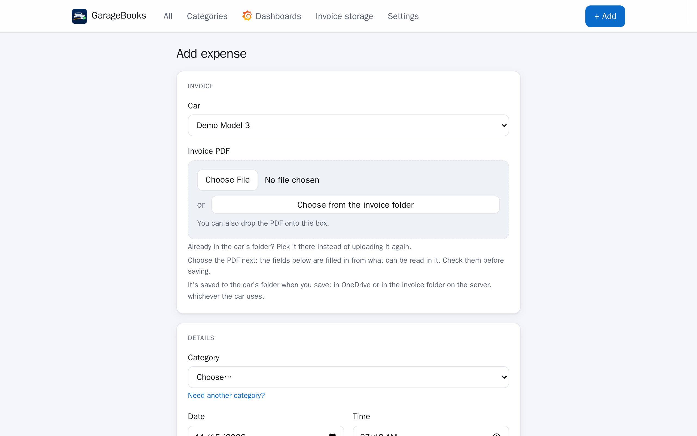

# GarageBooks

Track what your Tesla costs to own.
Record every expense (purchase, insurance, registration, tyres, servicing) in a small web app, and see
the total cost of ownership in TeslaMate's own Grafana, alongside the charging costs TeslaMate
already tracks.

!!! warning "Vibe coded"

    This project was written with an AI coding assistant (Claude Code), directed
    and tested by a person, not hand-written or audited line by line. It has tests, runs in a
    read-only, non-root container and only writes inside its own `garagebooks` schema, but treat it as
    you would any young, unreviewed software: back up your TeslaMate database before first use, and
    read the code before you trust it with anything you care about.

New here? Start with [Setup](setup.md).

## The dashboard

The **Cost of Ownership** dashboard in Grafana: total cost of ownership, purchase vs running vs
charging, cost per km, per day and per month, monthly spend by category, cumulative cost, and a
table of every expense with a link to its invoice. [What the dashboard counts](dashboard.md) explains
each figure.



## The expense list

Every expense, with its category colour, the total and a link to the invoice. Sort by any column,
either way (click a heading, or use **Sort by** and **Order**), and switch between rows and tiles with
the toggle beside the filter. In rows, drag the edge of a column heading to make that column wider or
narrower (double-click it for the usual widths); your widths are remembered in the browser. Refunds
and rebates show in green, and the app follows your device's light or dark setting.





## Cars

The **Cars** page lists your cars. The ones TeslaMate tracks are added by themselves and follow
TeslaMate's name until you rename them here. Any other car, electric or not, is added by hand, with
its type, make and model; TeslaMate isn't needed at all. The name is optional: a car with none is called
by its make and model. The purchase price, date bought and odometer at purchase are edited on the car's
card too. They are kept as one expense in a purchase category, so the price counts once; a car with
several purchase expenses is edited in the expense list. Each car shows its latest odometer: TeslaMate's,
or else the odometer on its latest expense. The page also says whether TeslaMate is connected, not
configured, or unavailable and why.

<!-- screenshot: cars-page - The Cars page, with a TeslaMate car and a car added by hand -->

A car paid for through a novated lease has a **Lease** link: the details from the provider's
statement, its yearly budgets (when [budgets are turned on](leases.md#lease-budgets)) and a few checks on them. See [Leases](leases.md).

### Selling a car

When you sell a car, open **Sold this car?** on its card and enter the date it sold and what it sold
for (0 if it was given away), and the final odometer, then **Save sale**. The final odometer is required
for a car TeslaMate doesn't track, and optional for one it does (leave it empty to use TeslaMate's). The card then reads *Sold 12 Mar 2026 for $31,000.00*.
**Clear sale** takes it back if you entered it by mistake. The date can't be in the future; a date
before the car's first expense is accepted, with a warning.

A sold car is not removed. Its total cost of ownership is the purchase price plus running costs and
charging, **less the sale price**; the time owned, and so every per-day and per-month figure, stops at
the sale date; and the distance stops at the final odometer, or the last odometer known on or before the sale date. You can still add
an expense to a sold car (a late bill, say), but it goes after your other cars in the Add form's car
list, marked *(sold)*. The dashboard names the car *(sold)* in its **Car** box and shows a **Sold**
tile. See [What the dashboard counts](dashboard.md).

<!-- screenshot: cars-sold - A car marked as sold on the Cars page, with its sale date and price -->

## Reminders

The **Reminders** page keeps track of what a car needs next: service that falls due on a date, an
odometer reading or whichever comes first, repeating ones such as a tyre rotation every 10,000 km, and
the registration and lease end from a car's lease. Resolve one by linking the expense that did the
job. See [Reminders](reminders.md).

## Adding an expense

Category, date, time, amount, odometer, vendor, notes and the invoice. The odometer can be filled in
from TeslaMate's own position data for the chosen date and time: the **Fill from TeslaMate** button
appears only for a car that TeslaMate tracks, and only while TeslaMate is connected. The amount field works out sums
(`120.50+89.95`, `400/3`) when you leave it, press Enter or save, and has keys for the operators.
Editing an expense, then saving or cancelling, returns you to the category and order you were
looking at.



<!-- screenshot: amount-calculator - The amount field with a sum typed in and its result -->

### Payment calculator

When a payment is made of several parts, open **Payment calculator** under the amount field to
work out what it really cost. A $100 gift card bought for $95, plus $42.50 in cash, covers a $142.50
invoice for a true cost of $137.50.

1. Add a part for each payment. Enter its face value, then choose how it cost you: **an amount paid**
   (the $95 you paid for the gift card), **a percentage off** (5% off), or **the full value (cash)**.
2. The calculator shows the invoice total covered, the true cost and the saving. Empty parts are
   ignored. A part that doesn't make sense, such as a discount over 100%, is outlined and stops the
   total until you fix or remove it.
3. Press **Use this amount** to put the true cost in the amount field, then save as usual.

Working is in whole cents and rounds to the nearest cent. The parts are not saved or sent anywhere:
only the amount you use is recorded, and the face value is not kept.

<!-- screenshot: payment-calculator - The Payment calculator open under the amount field, with a discounted gift card and a cash part -->

Choosing the invoice PDF fills in what can be read from it. With
[OneDrive uploads](onedrive.md) on, the PDF goes into that car's OneDrive folder (choose it, or drop
it onto the invoice box) and the link is filled in for you. Or keep them on your own
server: with an [invoice folder](local-folder.md) mounted (a NAS share, say), the app saves the PDFs
there, per car and category, and shows them itself behind your login. Invoices already in either can be
[imported](importing.md) in bulk.

Starter categories: Initial purchase, Insurance, Registration, Tyres, Service, Charging and Fuel. What a service
covered (filters, fluids, wipers, brakes, a wheel alignment...) is a list of **service items** chosen on each Service
expense, not a category each. Add more categories on the **Categories** page (new ones count as running costs).

## Change history

The **History** page lists every add, edit and delete of an expense or category, newest first: when,
who, and what changed (for an edit, each changed field as old → new; for an add or delete, the whole
row). Filter it by car, by expenses or categories, or by kind of change. It is read-only: if
something was changed or deleted by mistake, enter the old values again. See
[Reference](reference.md#change-history) for how it is recorded.

<!-- screenshot: change-history - The History page, listing an add, an edit and a delete -->

## How it fits together

The expenses live in their own `garagebooks` schema inside the TeslaMate database, so Grafana joins
them to TeslaMate's charging costs and odometer with no second datasource.

```
 browser ──► proxy + forward-auth ──► GarageBooks (Flask/gunicorn) ──► TeslaMate Postgres
                                                                       ▲   schema `garagebooks`
                                     Grafana (TeslaMate datasource) ───┘   + public.* (read-only)
```

The app has no login of its own, so it must sit behind a forward-auth gate: see [Setup](setup.md).

## Notices

This project is an unofficial community tool and is not affiliated with, endorsed by, or supported by the official TeslaMate project. It reads data from a [TeslaMate](https://github.com/teslamate-org/teslamate) database. Not affiliated with Tesla, Inc.

OneDrive is a trademark of Microsoft Corporation and Grafana is a trademark of Grafana Labs. This
project is not affiliated with or endorsed by either. The OneDrive and Grafana logos are fetched at
runtime from [selfh.st/icons](https://selfh.st/icons)
([CC BY 4.0](https://creativecommons.org/licenses/by/4.0/)); they are not part of this repository.
